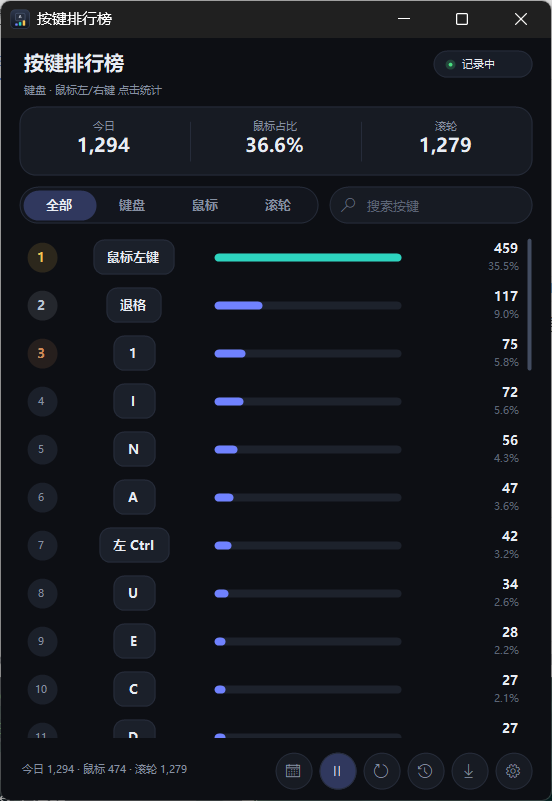
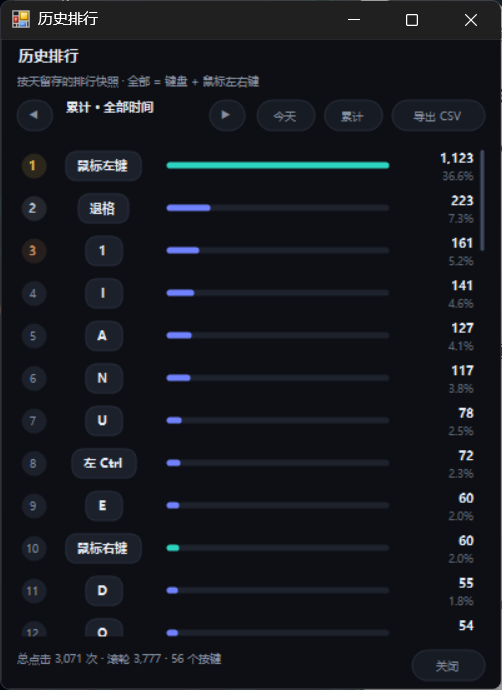
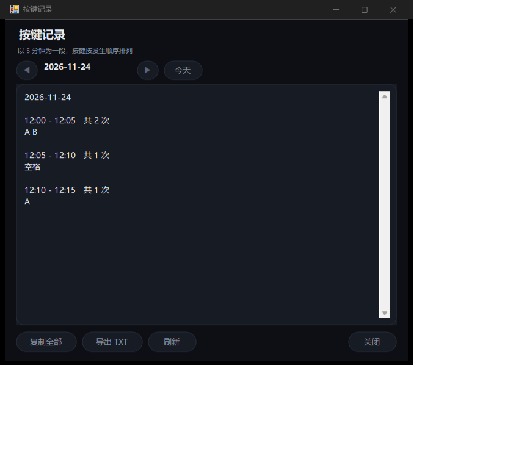

# ClickCounter · 按键排行榜

Windows 桌面小工具：全局统计每个按键与鼠标左/右键的点击次数，实时排行；可按 5 分钟一段、按发生顺序回看按过的键。



每天自动留档的「历史排行」：



## 下载

| 版本 | 文件 | 说明 |
| --- | --- | --- |
| v1.1.1 | [ClickCounter.exe](https://github.com/SZF1011/ClickCounter/releases/latest) | 单文件、免安装，双击即用；主页显示今日排行，历史里可看累计 |

首次运行 Windows 可能提示「已保护你的电脑」，点「更多信息 → 仍要运行」；程序会请求管理员权限（UAC），这样托盘图标、开机自启和任意目录导出才可用。

## 功能

- **全局计数**：键盘每个按键 + 鼠标左/右键 + **鼠标滚轮（上/下/左/右）**；按住键只记 1 次；无需管理员权限即可统计普通窗口
- **排行榜**：金/银/铜名次徽章、键帽、按当前最高值归一化的进度条、次数与占比
- **筛选与搜索**：全部 / 键盘 / 鼠标 / 滚轮，一键切换；按按键名称搜索
- **滚轮完全独立**：滚轮只在自己的页面统计，不计入总点击、今日、鼠标占比，也不计入排版行的百分比基数
- **历史排行**：每天自动留存一份排行快照（`history\日期.tsv`），主界面「历史」（`Ctrl+H`）按天翻看；窗口里的「累计」可查看全部时间的总点击排行
- **概览**：今日、鼠标占比、滚轮（三块数字，主页只显示今天；滚轮单列）
- **托盘常驻**：关闭窗口 = 最小化到托盘继续计数；双击托盘还原；右键托盘退出；**鼠标悬停托盘图标显示简要信息**（总计/今日/最常按的键/鼠标占比）
- **按键记录**：按 5 分钟一段、按发生顺序查看按过的键（`Ctrl+L`）
- **重置保护**：必须手动输入 `RESET` 才能确认清空，避免误操作
- **导出**：今日排行 CSV（可保存到任意目录）
- **系统集成**：窗口置顶、开机自启、单实例（再次启动会唤起已有窗口）；**默认以管理员身份启动**（可在设置里关闭），保证托盘/自启/任意目录导出可用
- **单文件**：`.NET Framework 4.8` 为 Windows 自带，无需安装 Python/Node/运行时

## 快速开始

1. 双击 `dist\ClickCounter.exe`；首次启动会请求管理员权限（UAC 点“是”），这样托盘图标、开机自启、任意目录导出才可用
2. 正常敲键盘、点鼠标，排行榜实时更新
3. 关闭窗口会收进托盘继续统计；要完全退出请右键托盘图标 → 退出

数据目录：默认 `%APPDATA%\KeyClickRank\`

- `stats.tsv`：各按键累计次数
- `logs\events-YYYY-MM-DD.tsv`：按键日志（每行“时间 + 键名”）

> 如果程序目录下已存在 `KeyClickRank-data`（曾经以受限方式启动过），会优先沿用这个便携目录，提权前后计数不会分家。
> 否则默认用 `%APPDATA%\KeyClickRank`；不可写时依次降级到 `%LOCALAPPDATA%\KeyClickRank`、程序目录 `KeyClickRank-data`、`%TEMP%\KeyClickRank`。
> 实际使用的路径可在“设置 → 关于 KeyRank”里看到；启动过程会写入 `ClickCounter-boot.log`（`%TEMP%` 或程序目录）。

## 按键记录（5 分钟一段）

每次按键按发生顺序记录到 `logs\events-YYYY-MM-DD.tsv`（每行“时间 + 键名”），只记录“按了哪个键、什么时间”，不记录输入的文字内容。

- 点底栏时钟图标，或按 `Ctrl+L`，或“设置 → 按键记录（5 分钟一段）…”打开查看器
- 每天一页，`◀ ▶` 切换有记录的日期，“今天”回到当天
- 每段显示时间范围与总次数，下面按发生顺序列出这一段按过的键：

```
2026-11-24  15:45 - 15:50   共 132 次
A S D F 空格 回车 左 Shift E ...
```

- **导出 TXT**：把当前日期的记录保存为 `.txt`（UTF-8，可自选目录；失败可管理员重试或改存数据目录）
- **复制全部**只放到剪贴板，不生成文件；设置菜单可“清空按键记录”

也可以命令行导出某一天：

```bat
dist\ClickCounter.exe --export-record "D:\out\按键记录.txt" --day 2026-11-24
```


- 记录仅保存在本机，不上传

## 重置保护

点底栏重置按钮会弹出确认框：必须输入 `RESET`（不区分大小写）后“重置”按钮才可点击，回车键同样生效。
该操作只清空排行榜计数，不改动日志。

## 快捷键

| 快捷键 | 功能 |
| --- | --- |
| Ctrl+P | 暂停 / 继续统计 |
| Ctrl+R | 重置统计（需输入 RESET） |
| Ctrl+L | 打开按键记录（5 分钟一段） |
| Ctrl+E | 导出排行榜 CSV |
| Ctrl+F | 定位搜索框 |

## 自检

```bat
dist\ClickCounter.exe --selftest
```

2 秒后自动退出，结果写入 `dist\selftest.txt`：`installed=True` 表示全局钩子安装成功。

## 构建

```bat
build.cmd
```

- 只使用系统自带 `C:\Windows\Microsoft.NET\Framework64\v4.0.30319\csc.exe`（C# 5 / .NET Framework 4.8.1）
- 不需要 Python、Node.js、Rust 或 .NET SDK
- 产物：`dist\ClickCounter.exe`；图标由 `tools\IconGen.cs` 现场生成 `app.ico`

## 目录

```
src\            主程序源码（Theme、KeyCatalog、InputHook、InputLog、StatsStore、Controls、RankList、ConfirmReset、MainForm、Program）
tests\          钩子 / 存储 / 日志的端到端测试源码（HookSmoke、StoreProbe、LogProbe）
tools\IconGen.cs 图标生成器（构建时使用）
build.cmd       一键构建
dist\           构建产物与 selftest 结果
docs\           截图
```

## 数据格式

`stats.tsv`：

```
# KeyRank v1
day<TAB>2026-11-24
daycount<TAB>812
total<TAB>7864
K_A<TAB>2104
M_L<TAB>812
```

- `K_*` 键盘按键，`M_L` / `M_R` 鼠标左/右键
- 文件损坏时自动备份为 `stats.bad-时间戳.tsv` 并从零开始

## 常见问题

**统计不到某些窗口？** 以管理员身份运行的程序、UAC 提示等受保护界面不会被普通权限钩子捕获；右键本程序“以管理员身份运行”即可完整统计。

**Windows 提示“已保护你的电脑”（SmartScreen）？** 点“更多信息”→“仍要运行”；这是未签名 exe 的常规提示。

**杀毒软件拦截 / 钩子安装失败？** 在安全软件中允许本程序；也可用管理员身份重试。程序会弹窗说明原因，不会崩溃。

**双击没反应 / 打不开？** 本版已把启动异常改成弹窗提示并写日志（`ClickCounter-boot.log`）。若仍无窗口：
1. 确认没有残留实例：任务管理器结束所有 `ClickCounter.exe` 后重试；
2. 不要从聊天/网页的“打开文件”预览里启动，直接在资源管理器双击 `dist\ClickCounter.exe`；
3. 被杀软拦截时，加入信任列表再试。

**关了窗口程序不见了？** 它缩到了系统托盘（右下角），双击图标即可恢复。

**首次启动弹出“需要更高权限”？** 当前启动方式（从聊天窗口/受限入口打开）不允许注册托盘图标、也不能写开机自启。点“是”并在 UAC 确认后，程序会以完整权限重启，托盘与自启即可正常；点“否”则以受限模式继续（关闭窗口最小化到任务栏），之后可在设置里再重启。

**右下角没有托盘图标？**
1. Windows 11 默认会把新图标收进 `^` 里：点任务栏的 `^`，把 ClickCounter 拖到外面；或在“设置 → 个性化 → 任务栏 → 其他系统托盘图标”里打开它。
2. 如果程序是从聊天窗口/受限入口启动的，Windows 会拒绝注册托盘图标（实测同环境下的最小 NotifyIcon 也注册失败）。此时请关闭程序，在资源管理器里双击 `dist\ClickCounter.exe`，或右键“以管理员身份运行”。
3. 新版检测到托盘不可用时会自动改为**最小化到任务栏**并弹窗说明，不会再“关闭后消失”。

**导出到“桌面/文档”提示没有权限？** 如果程序是从聊天窗口/受限入口启动的，它会继承一个受限令牌，系统会拒绝写入这些目录（这不是文件夹权限设置问题）。两种解决办法：
1. 设置菜单（齿轮）→ **以管理员身份重新启动**，在 UAC 弹窗点“是”，之后导出可保存到任意目录；
2. 或者关闭程序，在资源管理器里**右键 ClickCounter.exe → 以管理员身份运行**（或直接双击，若你的环境没有该限制）。

导出对话框是自绘的“另存为”，可直接输入任意路径；保存失败时还会提供“改存到数据目录”兜底。

**按键记录占空间？** 每次按键约 20 字节；可在“设置 → 打开日志文件夹”删除旧日期，或“清空按键记录”。

**重复运行？** 单实例：再次启动会唤起已运行的面板。

## 隐私说明

- 只记录“哪个按键、什么时间、多少次”
- **不记录**输入的文字内容、窗口标题、剪贴板或网络行为
- 全部数据保存在本机 `%APPDATA%\KeyClickRank`，日志可随时清空

## 限制

- Windows 10 / 11（x64），高 DPI 自适应；不使用安装包
- 不统计其他用户会话与安全桌面（UAC）
- 输入法组合键按实际按下的键统计

## 许可

[MIT](LICENSE) © 2026 SZF1011
